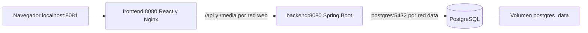

# Ejecución de KYNEX con tres contenedores

La aplicación se ejecuta con una responsabilidad por contenedor: React servido por Nginx, Spring Boot y PostgreSQL. Docker Compose coordina los tres servicios. No se necesita instalar Java, Node ni PostgreSQL en el equipo anfitrión para ejecutar esta modalidad; sí se requieren Docker Desktop con contenedores Linux, Docker Compose y Git.

## Organización de las carpetas

```text
carpeta-elegida/
├── Fs2_pROYECTO/      Dockerfile del frontend y configuración Nginx
└── kynex-backend/     Dockerfile del backend, compose.yml y .env privado
```

Si el frontend tiene otro nombre o ubicación, se modifica `FRONTEND_CONTEXT` en el `.env` del backend. La ruta relativa se interpreta desde la carpeta del backend. Los dos repositorios deben incluir sus cambios Docker.

## Primera ejecución

Descargar ambos repositorios y situarse en el backend. En la entrega Docker se utiliza la rama `codex/ep3-docker` de cada repositorio, hasta integrar las propuestas correspondientes.

```powershell
git clone --branch codex/ep3-docker https://github.com/AlexanderLlanten/Fs2_pROYECTO.git
git clone --branch codex/ep3-docker https://github.com/AlexanderLlanten/kynex-backend.git
cd kynex-backend
Copy-Item .env.example .env
notepad .env
```

Se completan `DB_PASSWORD`, `JWT_SECRET`, `BOOTSTRAP_ADMIN_EMAIL` y `BOOTSTRAP_ADMIN_PASSWORD` con valores propios. El secreto JWT debe tener al menos 32 bytes; una contraseña no debe reutilizarse como secreto JWT. Este comando genera un valor local para copiar a `JWT_SECRET`:

```powershell
$bytes = New-Object byte[] 48
$generator = [System.Security.Cryptography.RandomNumberGenerator]::Create()
$generator.GetBytes($bytes)
[Convert]::ToBase64String($bytes)
$generator.Dispose()
```

Si ya existe una configuración válida, se conserva el `.env`; no se reemplazan sus claves ni la contraseña de una base existente. Docker Compose lee ese archivo automáticamente. No se necesita cargarlo con PowerShell para usar Compose.

```powershell
docker compose up --build -d --wait
docker compose ps
```

La primera compilación descarga imágenes y dependencias. Se espera a que los tres servicios estén saludables antes de abrir el sitio.

| Responsabilidad | Servicio Compose | Dirección predeterminada en el equipo |
| --- | --- | --- |
| Frontend | `frontend` | http://localhost:8081 |
| Backend y Swagger | `backend` | http://localhost:8082/swagger-ui.html |
| Salud del backend | `backend` | http://localhost:8082/actuator/health |
| Base de datos para pgAdmin | `postgres` | localhost y el valor de `DB_PORT` |

Los puertos publicados se limitan al equipo local. `FRONTEND_PORT`, `BACKEND_PORT` y `DB_PORT` permiten cambiarlos. Si 5432 ya está ocupado, se utiliza por ejemplo `DB_PORT=5433`. Para ejecutar Java directamente fuera de Docker, `DB_URL` debe utilizar ese mismo puerto publicado.

La cuenta inicial de Administrador se crea solo cuando se configura y el correo todavía no existe. Si la base ya contiene cuentas, se conservan. Cambiar las variables bootstrap no reemplaza la contraseña de una cuenta anterior.

## Comunicación y responsabilidades



El navegador solicita `/api/v1` en el mismo origen del sitio. Nginx conserva la ruta y la deriva a `backend:8080`; también deriva las imágenes `/media`. El navegador no intenta resolver nombres internos de Docker. Las URLs absolutas siguen funcionando para el desarrollo con Vite.

Las cookies HttpOnly y la cabecera CSRF atraviesan el proxy. El backend conserva JWT, renovación, roles y propiedad. CORS incluye el origen local del frontend Docker además de los orígenes configurados. Para esta ejecución HTTP local se usa `COOKIE_SECURE=false`; un despliegue HTTPS debe ajustar esa configuración y sus orígenes.

La red `web` conecta frontend y backend. La red `data` conecta backend y PostgreSQL; el frontend no comparte esa red. El backend utiliza `postgres:5432`, independientemente del puerto elegido para pgAdmin. El volumen existente `postgres_data` conserva cuentas, compras, rutinas y consultas. El proyecto sigue siendo un monolito modular en el backend: tres contenedores por responsabilidad no convierten sus módulos Java en microservicios.

Las imágenes de frontend y backend usan compilación en etapas y un usuario sin privilegios para ejecutar la aplicación. El frontend final contiene Nginx y los archivos compilados; el backend final contiene Java y el ejecutable. Los contextos de construcción excluyen `.env`, Git, informes, respaldos y dependencias del anfitrión.

Compose espera el healthcheck de PostgreSQL antes de arrancar Spring Boot y el de Spring Boot antes de iniciar el frontend. Nginx resuelve el backend mediante el DNS de Docker, incluso después de recrear ese servicio. React Router conserva el acceso directo y la recarga de rutas como `/productos/2`, `/perfil` o `/consultas`.

## Actualizar, detener y volver a iniciar

Después de actualizar ambos repositorios:

```powershell
docker compose up --build -d --wait
```

Para detener sin eliminar datos y volver a iniciar las mismas imágenes:

```powershell
docker compose stop
docker compose start
docker compose ps
```

`restart: unless-stopped` permite recuperar los servicios cuando vuelve a estar disponible el motor de Docker si no se detuvieron expresamente. Docker Desktop debe estar iniciado. Los logs se consultan con:

```powershell
docker compose logs --tail 100 frontend backend postgres
```

`docker compose down` retira contenedores y redes y conserva el volumen. No se utiliza `down --volumes` para actualizar o apagar una base que se desea conservar.

## Conservación de una instalación anterior

Se mantienen el nombre del servicio `postgres`, el volumen `postgres_data` y el proyecto Compose de la carpeta habitual `kynex-backend`. Se conserva su `.env` y `DB_PORT`. No se cambia el nombre de proyecto al actualizar una instalación existente: un nombre diferente crea otro volumen y una base independiente.

Se recomienda crear el respaldo habitual antes de actualizar el entorno. Las herramientas de copia y restauración siguen utilizando el servicio `postgres` y funcionan también cuando están activos los tres contenedores. La restauración continúa creando una base nueva y revocando únicamente sus sesiones.

Las instancias antiguas ejecutadas con Maven o Vite son independientes de Docker. Los valores predeterminados 8081 y 8082 permiten verificar los contenedores sin ocupar sus puertos habituales 5173 y 8080.

## Referencias técnicas

La evidencia del corte registra 753 pruebas de React, 17 comprobaciones HTTP a través del proxy, 11 comprobaciones de navegador después de recrear contenedores y 11 de copia y recuperación. Son conjuntos distintos. El flujo de CI de los tres servicios fija una revisión del frontend para mantener identificado el conjunto verificado; esa referencia se revisa al cambiar la integración entre repositorios. [Resultados y límites de la verificación](evidencias/docker-ep3.json).

- [Orden de arranque y healthchecks de Compose](https://docs.docker.com/compose/how-tos/startup-order/).
- [Redes y nombres de servicio en Compose](https://docs.docker.com/compose/how-tos/networking/).
- [Compilación en etapas](https://docs.docker.com/build/building/multi-stage/).
- [Proxy HTTP de Nginx](https://nginx.org/en/docs/http/ngx_http_proxy_module.html#proxy_pass).
